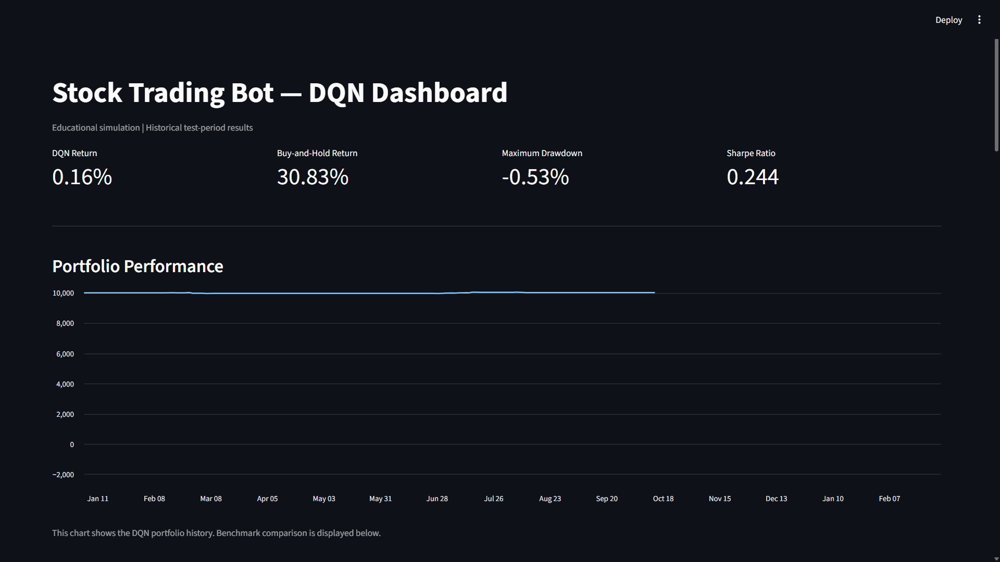
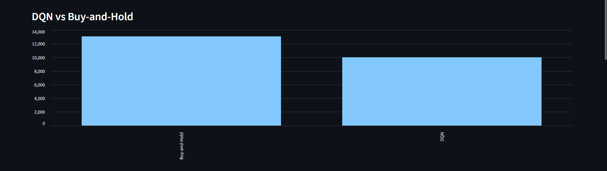
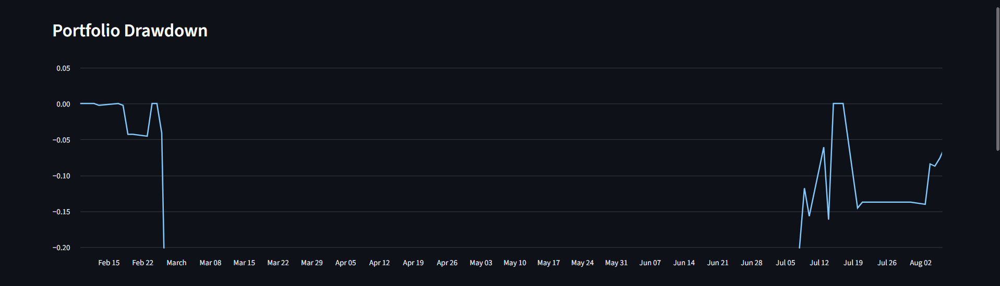
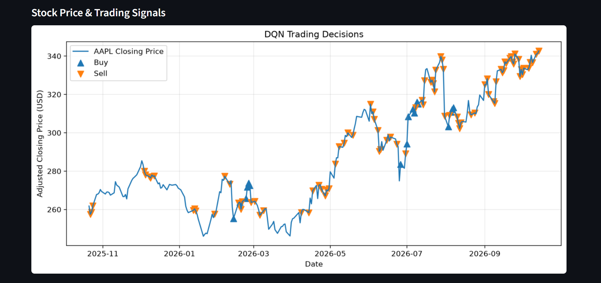
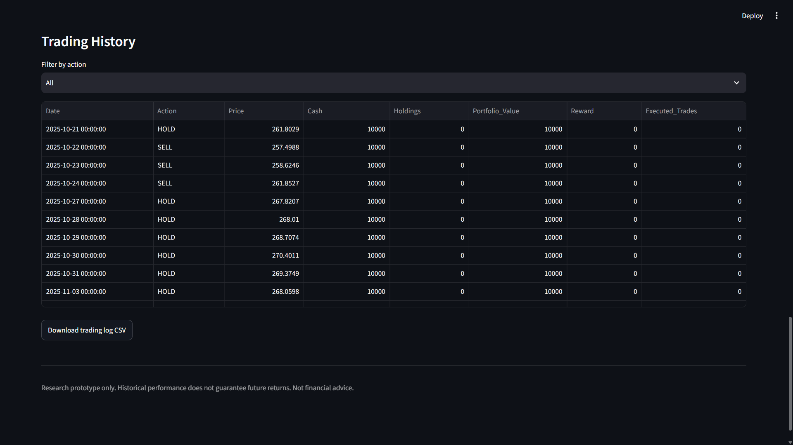

# Stock Trading Bot Using Deep Reinforcement Learning

## 📊 Dashboard Preview

The Streamlit dashboard provides an interactive view of the DQN trading agent's performance, trading signals, portfolio risk, and trade history.

### Dashboard Overview

### DQN vs Buy-and-Hold Benchmark

### Portfolio Drawdown

### Stock Price and Trading Signals

### Trading History

## 1. Project Overview

This project implements a stock trading simulation using Deep
Reinforcement Learning (DRL), specifically a Deep Q-Network (DQN).

The agent learns to select among three actions:

- Hold
- Buy
- Sell

The model is trained using historical stock market data and
evaluated on a separate chronological test period.

This is an educational research project and does not guarantee
profitable trading results.

## 2. Objectives

- Download and analyze historical stock prices.
- Calculate technical indicators.
- Build a custom stock trading environment.
- Implement a DQN agent using PyTorch.
- Train and evaluate the agent on historical data.
- Compare the agent with a Buy-and-Hold benchmark.
- Calculate portfolio performance metrics.

## 3. Technologies Used

- Python
- Pandas and NumPy
- Matplotlib
- PyTorch
- yfinance
- Visual Studio Code

## 4. Technical Indicators

- Daily Returns
- 10-day Simple Moving Average (SMA)
- 20-day Simple Moving Average (SMA)
- 10-day Return Volatility
- 14-day Relative Strength Index (RSI)

## 5. Reinforcement Learning Design

### State

The state includes five market features and two portfolio
features: normalized cash and the market value of holdings.

### Actions

- 0: Hold
- 1: Buy
- 2: Sell

### Reward

The reward is the change in portfolio value between steps,
including simulated transaction fees.

### DQN Components

- Neural network
- Experience replay buffer
- Target network
- Epsilon-greedy exploration
- Adam optimizer

## 6. Dataset and Experimental Setup

- Asset: Apple Inc. (AAPL)
- Data source: Yahoo Finance through yfinance
- Historical period: approximately five years
- Training/test split: chronological 80% / 20%
- Initial simulated capital: $10,000
- Transaction fee: 0.1% per executed trade
- Training episodes: 50
- Hardware: Local CPU

## 7. Initial Evaluation Results

| Metric                  |     Result |
| ----------------------- | ---------: |
| Initial Capital         | $10,000.00 |
| DQN Final Portfolio     | $10,015.62 |
| DQN Return              |      0.16% |
| Buy-and-Hold Return     |     30.83% |
| Executed DQN Trades     |         34 |
| Maximum Drawdown        |     -0.53% |
| Annualized Sharpe Ratio |      0.244 |

These are preliminary results from the current implementation.
The DQN strategy underperformed the Buy-and-Hold benchmark.

Results depend on the dataset, execution assumptions, transaction
costs, and experimental setup.

## 8. Project Structure

Stock_Trading_Bot_DRL/

- agents/
  - dqn_agent.py
- data/
  - AAPL_historical_data.csv
  - AAPL_processed_data.csv
- environment/
  - stock_trading_env.py
- outputs/
  - dqn_model.pth
  - portfolio_results.csv
  - evaluation_metrics.csv
  - drawdown_results.csv
- main.py
- train.py
- evaluate.py
- requirements.txt
- README.md

## 9. How to Run

Activate the virtual environment and install the dependencies
listed in requirements.txt.

Download and preprocess the historical data by running:

    python main.py

Train the model:

    python train.py

Evaluate the trained model:

    python evaluate.py

## 10. Limitations

- Historical performance does not guarantee future performance.
- The trading environment simplifies real market execution.
- Slippage and liquidity effects are not fully modeled.
- The DQN strategy has not outperformed the benchmark.
- Results require further robustness and sensitivity testing.

## 11. Future Improvements

- Improve execution timing and environment realism.
- Add transaction cost and slippage sensitivity tests.
- Compare DQN with other reinforcement learning algorithms.
- Evaluate multiple stocks and market conditions.
- Add a dashboard for visualizing results.
- Test reproducibility across multiple training seeds.

## 12. Disclaimer

This project is for educational and research purposes only.
It is not financial advice and should not be connected to a live
brokerage account without rigorous independent testing.
